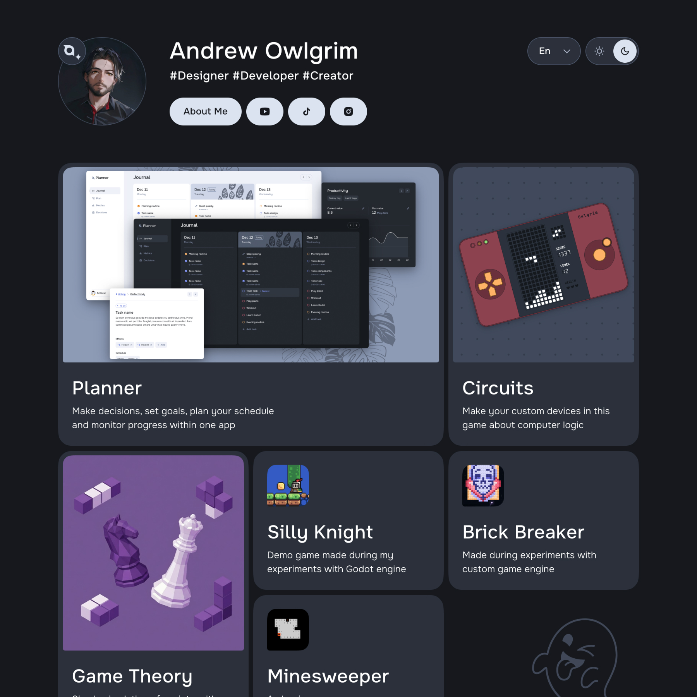

# Andrew Owlgrim Website

Personal website showcasing projects, experiments, and ideas.  
The site serves as a place to present projects, and as an experiment field for frontend features.

🔗 [Visit site](https://andrew-owlgrim.web.app)

## Features

- Multipage architecture
- Modular page structure
- Internationalization (multi-language support)
- Theme switching (light / dark)
- Custom design system based on Radix Primitives and SCSS
- Responsive layout
- Animated UI interactions

## Tech Stack

- Vite
- React
- TypeScript
- SCSS
- React Router v7 (framework mode)
- Radix UI
- Motion
- Swiper

---

##### License

This project is not intended for redistribution or reuse without permission.
